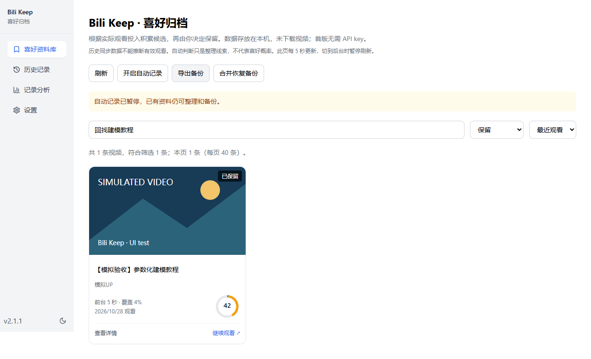
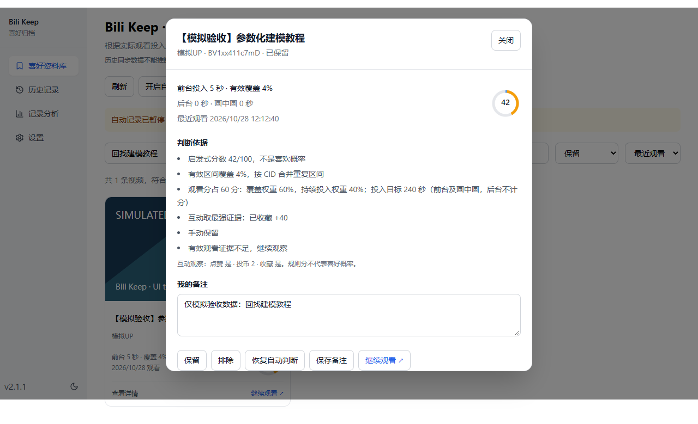

<p align="center"></p>

# Bili Keep · B站喜好归档

自动记录普通视频的观看投入，在本机整理可能喜欢的视频，方便以后回找。

基于 [rmqg/bilibili-history-sync](https://github.com/rmqg/bilibili-history-sync) 二次开发，保留原有历史同步、检索和分析。当前源码版本 **2.2.0**，面向桌面 Chrome / Edge。本项目非哔哩哔哩官方产品。

## 功能

- 记录实际播放、前台 / 后台 / 画中画、有效覆盖区间及分 P 位置；暂停、缓冲和拖动跳转不计作已观看内容。
- 用封面网格浏览候选与保留视频；评分环可悬停或键盘聚焦查看覆盖、投入、互动和重访的贡献。
- 点击封面、标题或“查看详情”查看判断依据和会话，编辑备注，手动保留、排除或恢复自动判断。
- 多关键词可分别匹配标题、UP 主、分 P 标题、BV 号、备注和标签，也可直接粘贴普通视频链接；支持状态/有备注/标签筛选，按时间、分数或标题排序。
- “继续观看”显示最近分 P 和播放位置并在新标签页打开；“打开视频”提供不带续播参数的入口。
- 在视频页打开扩展，主动保存当前时间点及简短说明；暂停自动记录时仍可用，不生成虚假的观看会话。在资料库编辑说明、导出Markdown，回跳前按CID核实最新分P；来源失效时明确提示。
- 每个视频可添加或移除轻量标签，最多12个、每个32字符。未实际观看的视频也能通过独立时间标记列表回找。
- 本地保存，支持 JSON 备份与合并恢复；无需 API key，不下载视频文件，不自动点赞、投币或收藏。



_资料库示例：模拟数据。_



_详情示例：模拟数据。_

## 安装与使用

需要 **Node.js >= 24** 和项目 `package.json` 指定的 pnpm 版本。在源码根目录运行：

```sh
pnpm install --frozen-lockfile
pnpm build
```

在 Chrome 打开 `chrome://extensions/`，开启“开发者模式”，选择“加载已解压的扩展程序”，加载 `.output/chrome-mv3`。Edge 可运行 `pnpm build:edge`，在 `edge://extensions/` 加载 `.output/edge-mv3`。

刷新已经打开的 B 站普通视频页面，正常播放后点击扩展图标进入喜好资料库。默认显示全部记录，尚未成为候选的视频也可回找；可切换“候选与保留”“已观察”或“有备注”，也可随时暂停自动记录。

更新时构建并重新加载**原目录中的同一个扩展**，然后刷新 B 站页面。更换加载目录前先导出资料库，切换后合并恢复。完整步骤及排查见 [安装与更新](docs/INSTALL.md)。

## 喜好分怎么算

分数是可解释的启发式规则，**不是喜欢概率**，也未按个人样本校准。

观看分最多 60 分，由“有效覆盖率”和“持续投入”加权组成。投入只计前台及画中画的真实播放时间，后台不计分；持续投入达到目标后该项不再增加。

| 已观察分 P 的总时长  | 覆盖 / 投入权重 | 投入目标           |
| -------------------- | --------------- | ------------------ |
| ≤ 3 分钟             | 80% / 20%       | min(时长, 60 秒)   |
| > 3 分钟且 ≤ 20 分钟 | 60% / 40%       | min(时长, 300 秒)  |
| > 20 分钟            | 35% / 65%       | min(时长, 1200 秒) |

```text
观看分 = 60 × [覆盖权重 × 有效覆盖率 + 投入权重 × min(有效投入 / 投入目标, 1)]
总分 = min(100, round(观看分 + 互动分 + 重访分))
```

- **互动分**：本人点赞 +15、投币 +30、收藏 +40，取最强一项，不叠加。
- **重访分**：至少两次前台观看各满 10 秒，且开始时间间隔至少 30 分钟，+10。
- **状态**：总分 ≥ 50 且有效投入 ≥ min(10 秒, 已观察总时长)，成为候选；已观察到收藏或手动保留时为“已保留”；手动排除优先。无时长的记录不自动进入候选。

有效覆盖按 CID 合并重复区间，拖动不补齐跳过内容。多 P 视频只计算实际观察到的分 P，不代表整套课程完成率。原始合计可能超过 100，界面分数封顶为 100；此时评分环按原始合计展示各项贡献。

## 数据与隐私

喜好资料库保存在当前浏览器的独立 IndexedDB `biliKeepLibrary`，包括观看会话、互动快照、手动状态、备注、时间标记和标签。2.2.0将数据库结构升级到版本2，旧观看数据保持原位。上游历史使用 `bilibiliHistory`，两者分开保存，历史接口的 `progress` 不会被当作真实观看证据。

使用“导出完整备份”和“合并恢复备份”迁移资料库。完整JSON v2包含观看、决定、标记、删除信息和标签；仍可读取旧v1。导入先校验再同事务合并，不清空已有记录，旧备份不复活较新的删除；不同说明的冲突保留副本。v1兼容导出会明确省略标记与标签，不能替代完整备份。

从2.1.x升级前先在旧版导出最新资料库，并保留原构建。数据库升级后旧版不能直接打开同名库，v1兼容JSON不会降低数据库版本；本轮不提供原地降级工具。常规更新保持原扩展身份，不通过卸载处理。详见[安装与更新](docs/INSTALL.md)。

记录保存在本机，但读取历史、本人互动状态和封面仍会请求 B 站及其 CDN。保留的可选云同步只覆盖上游历史，由用户主动配置；**不包含喜好资料库**，不能替代资料库 JSON 备份。扩展不调用 LLM。

## 限制与验证

仅采集桌面网页 `https://www.bilibili.com/video/` 下的普通视频；手机 App、番剧、直播和旧历史不能补出真实观看区间。采集依赖播放器 DOM 和只读接口，B 站更新、登录状态、网络或风控可能影响记录与互动查询。未知互动不当作否定证据；历史点赞及离开页面前的互动可能未能及时观察到。异常关闭时最近约 5 秒的播放可能尚未保存。

2.2.0通过 **67项单元测试、类型检查、Chrome/Edge生产构建及隔离Edge检查**。隔离检查使用模拟 B 站页面/API，覆盖媒体播放、暂停/切P标记、CID重排和失效、标签、备份及重启；这些不等于真实 B 站环境所有场景均已通过。

开发检查：

```sh
pnpm test
pnpm compile
pnpm build
```

隔离检查入口为 `scripts/browser-smoke.mjs`，需要 Playwright 和支持加载开发扩展的 Chromium / Edge；可通过 `PLAYWRIGHT_MODULE`、`BROWSER_EXECUTABLE` 指定已有环境。格式化仅针对实际修改文件，避免无关文件的换行改动。

## 来源、鸣谢与许可证

感谢以下项目的作者、维护者和贡献者：

- 直接上游：[rmqg/bilibili-history-sync](https://github.com/rmqg/bilibili-history-sync)。Bili Keep 基于提交 [`bda07e3`](https://github.com/rmqg/bilibili-history-sync/commit/bda07e3dc020976ecbe53bd34673114458994a13)，沿用历史同步、检索、分析及扩展基础；许可证为 **GPL-3.0-only**。
- 更早上游：[mundane799699/bilibili-history-wxt](https://github.com/mundane799699/bilibili-history-wxt)。感谢其历史记录扩展基础，原始代码适用 **MIT License**，相关版权和许可文字继续保留。

Bili Keep 新增真实播放采集、独立喜好资料库、规则评分、封面网格与详情、手动整理和资料库备份。软件按 [GPL-3.0-only](LICENSE) 分发，保留 [MIT 许可证](LICENSE-MIT) 与 [来源声明](NOTICE)；分发修改构建时应同时提供对应源码。

图标由使用者提供，原作者及独立许可信息尚未提供；软件 GPL 许可不构成对图标内第三方素材的授权。
